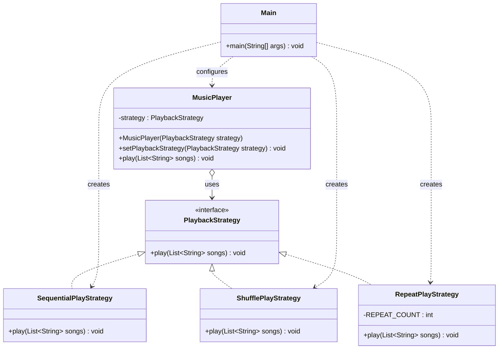

# Music Player — Strategy Pattern

**Course:** Software Design Patterns  
**Assignment:** #5 — Strategy Pattern  
**Language:** Java

## 1. Project Description

This project demonstrates the Strategy design pattern using a simple Music Player application.

The music player supports three playback modes:
- **Sequential Play** — plays songs in their original order.
- **Shuffle Play** — plays songs in a random order.
- **Repeat Play** — repeats the first song three times.

The user can switch between playback strategies at runtime without modifying the `MusicPlayer` class.

## 2. Design Pattern

The **Strategy Pattern** is a behavioral design pattern that defines a family of algorithms, encapsulates each one, and makes them interchangeable.

In this project, each playback mode is implemented as a separate strategy. The `MusicPlayer` class delegates playback to the selected strategy instead of implementing the playback algorithms itself.

## 3. UML Class Diagram



## 4. Project Structure

```text
MusicPlayer/
└── src/
    ├── PlaybackStrategy.java
    ├── SequentialPlayStrategy.java
    ├── ShufflePlayStrategy.java
    ├── RepeatPlayStrategy.java
    ├── MusicPlayer.java
    └── Main.java
```

## 5. Main Components

| Component | Responsibility |
|---|---|
| `PlaybackStrategy` | Defines the common playback algorithm interface. |
| `SequentialPlayStrategy` | Plays songs in their original order. |
| `ShufflePlayStrategy` | Randomizes the song order before playback. |
| `RepeatPlayStrategy` | Repeats the first song three times. |
| `MusicPlayer` | Stores the current strategy and delegates playback to it. |
| `Main` | Creates the playlist, selects strategies, and demonstrates switching between them. |

## 6. How It Works

1. The client creates a playlist of songs.
2. The client creates a `MusicPlayer` with `SequentialPlayStrategy`.
3. The player executes the selected strategy.
4. The client switches to `ShufflePlayStrategy`.
5. The player executes the new strategy without changing its own code.
6. The client switches to `RepeatPlayStrategy`.

The key method is:

```java
public void play(List<String> songs) {
    strategy.play(songs);
}
```

The `MusicPlayer` does not need to know which concrete strategy is being used. It simply calls the common interface method.

## 7. Clean Code Principles

### 1. Polymorphism Instead of Conditional Logic

The program uses polymorphism instead of `if/switch` statements to select playback algorithms inside `MusicPlayer`.

Each strategy implements the same interface and provides its own behavior.

### 2. Meaningful Names

Class and method names describe their responsibilities clearly.

For example, `ShufflePlayStrategy` indicates that the class implements random playback.

### 3. Single Responsibility Principle (SRP)

Each class has one main responsibility:
- `MusicPlayer` manages the selected strategy.
- `SequentialPlayStrategy` plays songs sequentially.
- `ShufflePlayStrategy` randomizes the playback order.
- `RepeatPlayStrategy` repeats a song.
- `Main` configures and runs the demonstration.

### 4. Encapsulation

Each playback algorithm is encapsulated in its own class. The implementation details of one strategy do not need to be placed inside the `MusicPlayer` class.

### 5. Open/Closed Principle (OCP)

The application can be extended with new playback strategies without modifying the existing `MusicPlayer` class.

For example, a `LoopPlaylistStrategy` could be added to repeat the entire playlist.

### 6. Abstraction and Loose Coupling

`MusicPlayer` depends on the `PlaybackStrategy` interface rather than concrete strategy classes. This reduces coupling and makes strategies easier to replace and test.

## 8. Example Output

```text
Sequential Play:
Playing: Blinding Lights
Playing: Starboy
Playing: Save Your Tears
Playing: The Hills
Playing: Die For You

Shuffle Play:
Playing: The Hills
Playing: Die For You
Playing: Blinding Lights
Playing: Save Your Tears
Playing: Starboy

Repeat Play:
Playing: Blinding Lights (repeat 1)
Playing: Blinding Lights (repeat 2)
Playing: Blinding Lights (repeat 3)
```

The order in Shuffle Play can vary between executions.

## 9. How to Run

**Requirements:**
- Java Development Kit (JDK)
- IntelliJ IDEA or another Java IDE

**Steps:**
1. Create a Java project named `MusicPlayer`.
2. Create the six Java files listed in the project structure.
3. Copy the corresponding source code into each file.
4. Open `Main.java`.
5. Run the `main()` method.

No external libraries are required.

## 10. Advantages of the Strategy Pattern

- Playback algorithms can be changed at runtime.
- New playback modes can be added easily.
- The context does not contain conditional logic for selecting algorithms.
- Each strategy can be tested independently.
- The code is easier to maintain and extend.

## 11. Limitations

This project is a console-based simulation, not a real audio player. It demonstrates playback behavior through console messages.

The repeat strategy repeats the first song three times for demonstration purposes.

## 12. Defense Questions and Answers

**Q1. What is the Strategy Pattern?**

It is a behavioral design pattern that encapsulates interchangeable algorithms and allows them to be selected at runtime.

**Q2. What is the Strategy interface in this project?**

`PlaybackStrategy` defines the common `play()` method for all playback algorithms.

**Q3. What is the Context?**

`MusicPlayer` is the Context because it stores a reference to a strategy and delegates playback to it.

**Q4. What are the Concrete Strategies?**

`SequentialPlayStrategy`, `ShufflePlayStrategy`, and `RepeatPlayStrategy`.

**Q5. How can the strategy be changed at runtime?**

By calling `setPlaybackStrategy()` with another implementation of `PlaybackStrategy`.

**Q6. Why does `MusicPlayer` not use `if/switch` statements?**

It delegates execution through the common interface. Polymorphism determines which implementation runs.

**Q7. How can a new playback mode be added?**

Create a new class that implements `PlaybackStrategy`. The existing `MusicPlayer` class does not need to be modified.

**Q8. What is the difference between Strategy and inheritance?**

Inheritance can provide shared or overridden behavior through a class hierarchy. Strategy uses composition to delegate behavior to a replaceable object.

**Q9. Why is this design easier to test?**

Each strategy has its own implementation and can be tested independently of the player.

**Q10. Which Clean Code principles are demonstrated?**

Single Responsibility Principle, meaningful naming, encapsulation, polymorphism instead of conditional logic, Open/Closed Principle, and loose coupling.

## 13. Conclusion

The Music Player project demonstrates how the Strategy Pattern separates playback algorithms from the main application logic.

By using a common interface and interchangeable strategies, the player supports different playback modes while remaining easy to maintain, test, and extend.
